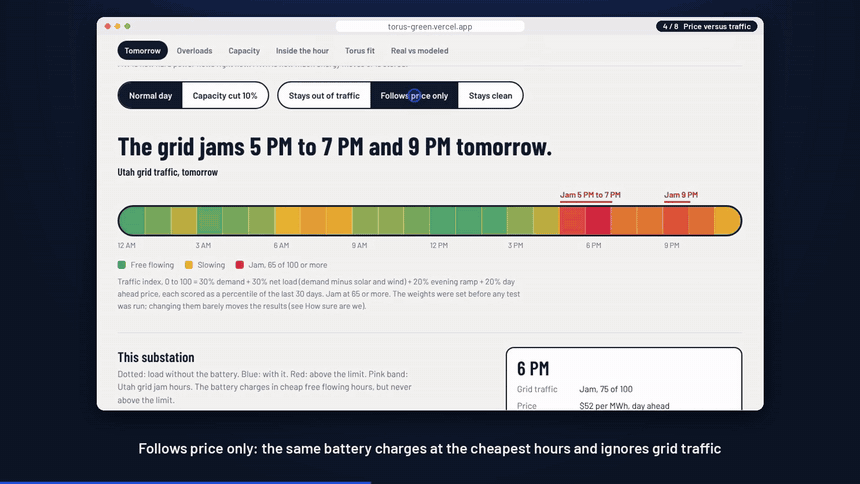
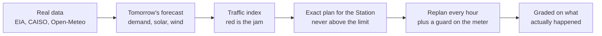

# Substation Rush Hour

A traffic report for tomorrow's Utah grid, and a plan that keeps a Torus style Station out of the jam. Graded on what actually happened.

**Live demo:** https://torus-green.vercel.app (refreshes itself every day from EIA, CAISO and Open-Meteo)
**Demo video, 100 s:** [download demo.mp4](https://github.com/garzonandres2004/substation-rush-hour/raw/main/docs/media/demo.mp4) (the clip below plays right here)

Built solo in 48 hours for the Hard Tech Week Hackathon, Torus bounty Option 1 "Rush Hour for Electrons".

[](docs/media/demo.mp4)

## How I got here

I come from logistics, not energy. So when Torus said "rush hour for electrons" I didn't think about kilowatts first, I thought about roads.

| On the road | On the grid |
| --- | --- |
| A bridge with a weight limit | The substation and its rating |
| Rush hour traffic | Demand peaks, the evening ramp when solar fades, high prices |
| A warehouse next to the bridge | The battery (Torus Pulse) |
| Sending trucks across | Charging, it adds load to the substation |
| Delivery motorbike for quick runs | The flywheel (Torus Spin), fast swings |
| A traffic cop at the bridge | The real time guard on the meter |

If you send your trucks across at the cheapest hour without checking traffic, you can cause the jam yourself. That became the whole project.

**The questions I asked, in order**

1. When is the grid jammed tomorrow? So I built a traffic index from real demand, net load, ramp and price.
2. Can a battery stay out of the jam and still be useful? So I built an exact planner that charges in free flowing hours and discharges into the jam, never above the limit.
3. Does it hold up on real days, not on my own forecast? I graded every day on the demand that really showed up. My first version failed: its own charging pushed the substation over the limit on 8 of 30 days, because the forecast missed by up to 9.5 MW.
4. How do I fix it? Replanning every hour still failed on 9 days. A safety margin cost about $85 a day more and still failed on 3. A guard that reacts to the meter fixed all of them for about $10 a day.
5. What does a utility actually want to know? Not dollars. How much new load, like a data center, fits on the same wires. 1 MW without storage, 5.75 MW with a 10 MW, 4 hour Station.
6. What happens inside the hour? AI load swings every few seconds. The flywheel takes the swings so the battery keeps its plan.
7. Was the month just lucky? I walked the same plan over a full year of real days, planned each night on the weather forecast as it was issued. It never pushed the substation over its limit, 0 of 359 days.

**What inspired it**

1. The Torus brief itself: "a navigation app for electricity" and "a traffic report for tomorrow's grid".
2. Advice at kickoff: AI is a component, not the architecture. So code makes every decision and AI only explains it.
3. Torus asked for a world model of the grid as real as possible, so everything runs on public data and every number is labeled real, modeled or assumed.
4. Torus's own congestion steps (identify the constraint, deploy at the point of need, shape load, move more power on the same wires) and the way they schedule Stations against forecasts for smaller utilities through Lasso.
5. Rocky Mountain Power's loading guideline, 105 percent of nameplate in summer and 120 in winter, which told me the limit is real and physical.

**How I built it**

1. One hour of planning with no code: brief, rubric, phases, and checking that the data really exists ([docs/build-process](docs/build-process)).
2. Data first: EIA demand and forecasts, CAISO day ahead prices, Open-Meteo weather.
3. Engine: forecast, traffic index, exact dynamic programming planner, tests.
4. The page, then the backtest, then I broke my own plan and fixed it with the guard.
5. Capacity, the minute level Station model, the daily refresh, and plain English explanations checked by code.

## How it works



1. Forecasts tomorrow's demand, solar, wind and net load for PacifiCorp East, hour by hour.
2. Traffic index: 30 percent demand, 30 percent net load, 20 percent evening ramp, 20 percent day ahead price, each a percentile of the last 30 days. Above 65 of 100 is a jam.
3. Plans a modeled 10 MW / 40 MWh battery with exact dynamic programming, replans every hour from the last hour's forecast miss, and a real time guard on the meter holds the limit.
4. The substation is PacifiCorp East demand scaled to a 100 MW peak. Its limit is the 95th percentile of the trailing 30 days.
5. Each step gets a plain English reason. Gemini writes them once a day, `scripts/explain-check.ts` checks every number against the engine, and anything that fails falls back to plain numbers. The page makes no live model calls.

## Results

The live page recomputes these every day over the trailing 30 days, so it is the source of truth. Numbers below are from the Oct 28, 2026 refresh (Sep 27 to Oct 26).

| Question | Result |
| --- | --- |
| Days our own charging pushed the substation over its limit | Plan once: 8 of 30. Replan every hour: 9. With the guard: **0** |
| Same test on EIA's published day ahead forecast | Plan once: 12. With the guard: **0** |
| Battery that follows price only | Over the limit on 11 of 30 days |
| Jam relief, ours vs price plus the same guard | 11.8 vs 4.5 MWh a day, for about $12 a day |
| New load the substation can take, moving limit | 1 MW without storage, **5.75 MW** with a 10 MW, 4 h Station (a five line peak shaving rule gets 5.25) |
| Same, fixed rating of 92.1 MW | 2.75 MW without storage, 7.5 MW with the Station |
| Same, rated for the summer peak (July and August) | 7.25 MW with the Station |
| Inside the hour, simulated AI load | Hourly plan alone: 2,362 minutes over in 30 days. Battery chasing every spike: 0 minutes but about 61 power changes a day. Flywheel plus battery: 0 minutes, battery at about 12 changes a day |
| Demand forecast error | Ours 5.0 percent vs 8.6 percent for the day ahead forecast reported to EIA. Ours used observed weather here, so read it as an upper bound |

## The lab: trying to break our own results

**Live:** https://torus-green.vercel.app/lab. Eleven more tests on real open data. The safety held in every one, and three changed what we say. Rerun on Oct 29, 2026 with EIA hours read as hour ending.

| Test | Result | Verdict |
| --- | --- | --- |
| A full year, planned each night on weather forecasts as issued | Our plan made the substation worse on 0 of 359 days | Held |
| New load all year, substation rated at its annual peak | 0 MW without storage, 5.5 MW with a 10 MW, 4 h Station | Held |
| Real AI training power (MIT Supercloud, 44 jobs) | Swings repeat about every 5 seconds: our simulation had the size right, the speed wrong | Corrected our model |
| Inside the hour, second by second | Independent jobs: a 0.5 MW flywheel covers it. One synchronized run: a 4 MW flywheel | Corrected our claim |
| Did we tune it to win? 17 settings | 0 days made worse in all 17. Index ahead of price plus guard in 16, about 1.5 times over a year (3.2 on the 30 autumn days) | Held, smaller than it looked |
| Compute that yields to traffic | Pausing 0.5 percent of yearly energy: 17 MW with the Station (5.5 firm), about 121 hours a year | New |
| The limit as heat (IEEE C57.91), not a fixed number | Year round 5.5 to 6.5 MW. November to April 47 MW or more | New |
| A utility event in the jam: 2 hours at full power from the busiest hour | Ready on 24 of 30 days as planned. Holding a reserve for the busiest hour on the day ahead forecast: 30 of 30, for about $30 a day ($299 to $269), jam relief 9.4 to 9.9 MWh, 0 days over | New, closed |
| Many customer batteries behind one substation, built with [DETOUR](https://detourgrid.com) | 60 businesses cutting their own bills: 230 new hours over the limit. Guard on the meter: 119, at no cost to customers. Room traded by need plus guard: 63, customers keep 90%. With the utility's Station too: 2 new hours in 11 months, and fewer overload hours than the Station alone (130 vs 138) | New, nearly closed |

**Built with DETOUR.** Test K uses DETOUR by Juan Lizarazo (same bounty, MIT, used with his permission): Rocky Mountain Power Schedule 6 and 8 bills, three simulated businesses and his bill planner, vendored unchanged under `src/detour` (see its README). The main page has an interactive version (number of businesses, how they are coordinated) that reads the same results. `src/merge` adds the fleet guard and the substation's room inside his plan. `npx tsx scripts/merge-fleet.ts` rebuilds `public/data/merge-fleet.json` from the lab's EIA pull in `data/lab-raw`.

Lab data is pulled by branch workflows (`.github/workflows/lab-*.yml`) and is not refreshed daily. GPU traces are processed inside GitHub Actions and never saved (CC BY-NC-ND 4.0).

## Real, modeled, assumed

| Real data | Modeled | Assumed |
| --- | --- | --- |
| EIA demand, day ahead forecast, fuel mix (PACE) | Substation load, scaled from PACE demand | Station size and efficiency (88 percent round trip) |
| Open-Meteo temperature, sunshine, cloud cover | Solar and wind output from weather | Substation limit (P95 of the trailing 30 days) |
| CAISO day ahead prices at TH_PACE_GEN-APND | Traffic index and Station schedule | Stress premium and cycle cost |

The flywheel appears only in the minute level section, with simulated data center load and Torus's published claims. No Torus integration, API or data is used. Validation on a real feeder is the next step.

## Run it

```
npm install
npm run dev        # http://localhost:3000
npm test           # dispatch validity tests
npm run capacity   # capacity analysis (before engine)
npm run station    # minute level flywheel plus battery model (after capacity)
npm run engine     # rebuild public/data/report.json
npm run explain    # validate and cache the plain English explanations
npm run lint       # Biome
```

To refresh data, put an EIA key in `.env.local` as `EIA_API_KEY=...`, run `node scripts/ingest.mjs` and `node scripts/pull-prices.mjs`, then `npm run engine`.

## Daily refresh

`.github/workflows/daily-refresh.yml` runs every day at 21:30 UTC, after CAISO publishes next day prices. It pulls fresh EIA, CAISO and Open-Meteo data, runs the tests, capacity, station and engine, keeps only explanations that still check out, refuses to deploy a stale forecast, commits `public/data` and deploys to Vercel. Secrets: `EIA_API_KEY`, `VERCEL_TOKEN`, `VERCEL_ORG_ID`, `VERCEL_PROJECT_ID`, optional `GEMINI_API_KEY`.

## Layout

| Path | What |
| --- | --- |
| `src/engine/` | Forecast, traffic index, planner, guard, Station model, scoring, tests |
| `src/components/` | Dashboard and charts |
| `scripts/` | Data pulls, engine runner, capacity, station, explanations |
| `public/data/` | Daily output the page reads |
| `docs/media/` | Demo video and preview |
| `docs/build-process/` | Brief, plans, rules and prompts I used to build it |
| `app/lab`, `scripts/lab*`, `lab-data/` | The lab: deeper tests and their open data |

## Stack

Next.js, React, TypeScript, inline SVG charts, Biome, GitHub Actions, Vercel.
